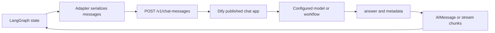

# Architecture

## Components

- `DifyUniversalChatModel` implements LangChain's `BaseChatModel` interface using Dify's official chat-messages API.
- `build_json_agent` composes model calls, JSON validation, a retry path, and local Python tools as a LangGraph.
- Dify's published chat application remains responsible for its configured workflow and underlying model.

## Data flow

In stateless mode, LangGraph owns the history and the adapter sends it in `query`; Dify `conversation_id` is omitted. In Dify-managed mode, only the latest human message is sent and the application must persist and reuse the returned conversation ID with a user-scoped identity.

## Tool execution boundary

The chat-messages API response contains an `answer` string. It is not an OpenAI-compatible tool-calling response. `build_json_agent` requests a JSON object such as `{"action":"lookup_order","args":{"order_id":"1001"}}`, validates the action name and arguments object, and invokes the corresponding local callable. The helper does not validate individual argument schemas or authorize actions; tool functions must do so.

## Why not an OpenAI-compatible Dify plugin?

This adapter targets deployments where users can access a Dify app API key but cannot install or configure provider plugins. It speaks directly to Dify's app API.
